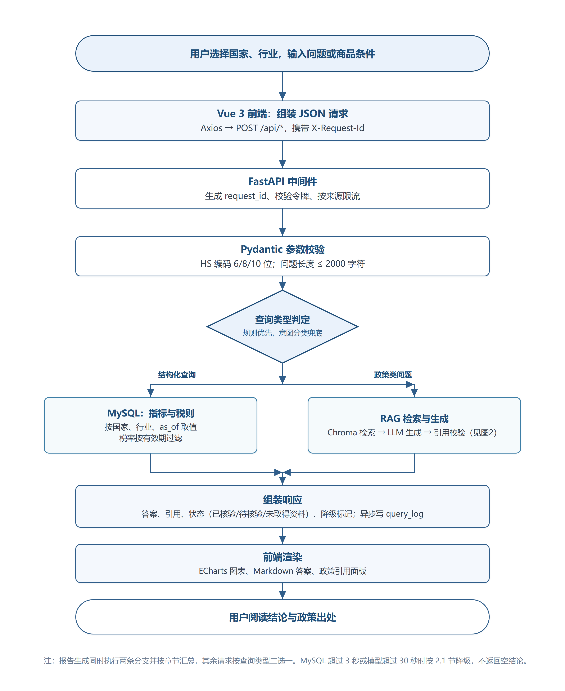
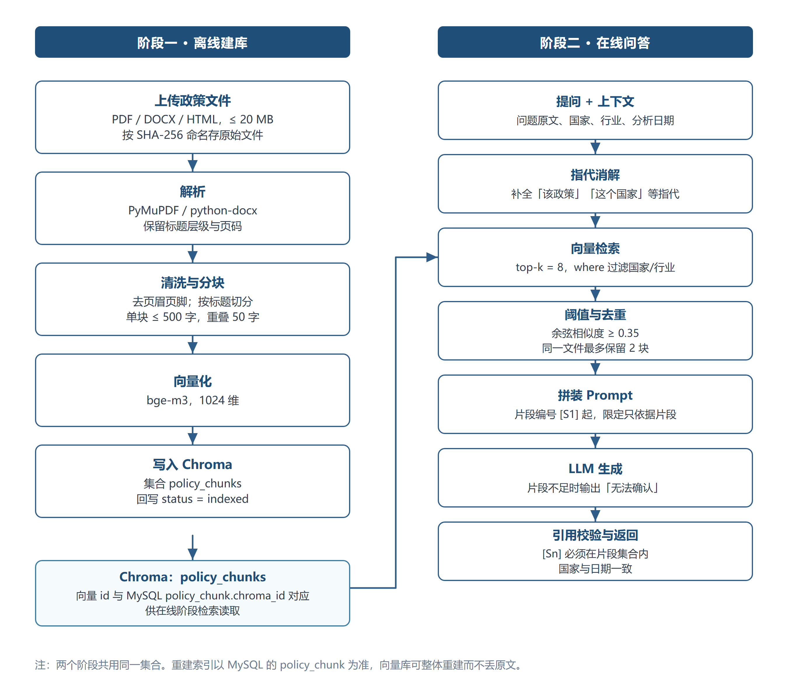
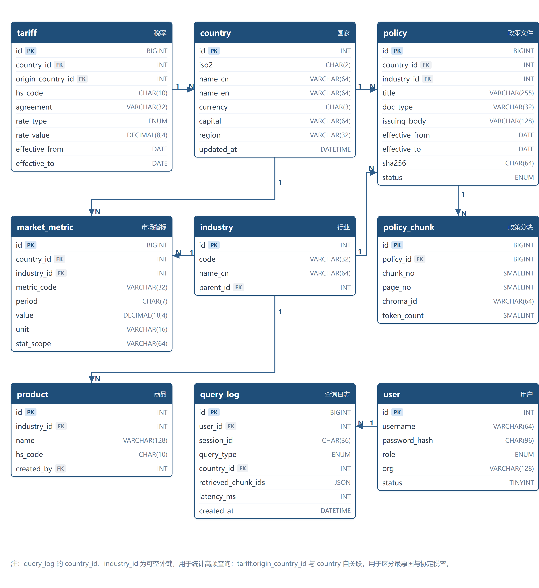

# 2 核心流程与数据设计

本章说明系统的请求链路、RAG 检索链路、对外接口和数据库结构。系统当前处于 V0.0 设计阶段，FastAPI 服务、MySQL 表与向量库尚未落地，本章给出的接口、字段和错误码作为后端实现与前端联调的依据，已实现与计划实现的内容在 2.5 节单独标注。

## 2.1 核心业务流程

*图1 核心业务流程*

系统有市场看板、合规筛查、AI 问答和报告生成四个入口，四者共用一条请求链路，差别在服务端的查询路由。

1. 用户在前端选定国家与行业，再输入问题或商品条件。看板点击国家标记、筛查表单选择目标国、问答页选择上下文，三种操作写入同一份前端状态，后续请求自动带上国家与行业，用户不必重复填写。
2. Axios 以 JSON 提交请求，基地址为 /api，超时 20 秒，请求头携带 X-Request-Id 和可选的 Authorization。
3. FastAPI 中间件做三件事：生成或透传 request_id、校验令牌（无令牌按匿名处理）、按来源限流。Pydantic 模型随后校验字段，HS 编码限定为 6 位、8 位或 10 位数字，问题长度不超过 2000 字符。
4. 路由判定以规则优先：出现“关税、税率、HS 编码、计税”走结构化查询，出现“政策、补贴、准入、认证”走检索，报告生成进入编排流程。规则未命中时调用一次意图分类，判定结果写入 query_log.query_type。这个判定只决定主路径，报告生成会同时用到两条。
5. 结构化分支按国家、行业和分析日期查 MySQL。税率按 as_of 落在有效期内过滤，返回结果带统计口径、年份和来源，避免把不同口径的数字直接比较。
6. 检索分支按 2.2 节执行，返回答案与引用。
7. 结果组装时统一附上结论状态（已核验、待核验、未取得资料、来源冲突、不适用）、缺失项和 request_id，并异步写入 query_log。日志写入失败只记应用日志，不影响这次响应。
8. 前端用 ECharts 渲染指标图，答案按 Markdown 展示，引用面板列出政策名称、条款或页码、生效日期与原文链接。没有可用来源时显示“暂无已核验来源”，这条规则同时约束模型输出。

降级规则按依赖分别设定。MySQL 查询超过 3 秒，返回检索结果并标记 degraded=["metrics"]，前端在图表位置提示数据暂不可用；向量库不可用返回 503，前端保留用户输入；最高相似度低于阈值或没有召回时，不调用模型下结论，返回 insufficient_evidence=true 和已检索到的政策条目；模型超过 30 秒，answer 置空、片段照常返回，前端标注“仅提供原文”。四种情况下用户都能看到已有依据，只有确实查不到时才提示无法确认。

## 2.2 RAG 流程

*图2 RAG 离线建库与在线问答流程*

RAG 分为离线建库和在线问答两段，两段共用 Chroma 中的 policy_chunks 集合。

离线建库共六步。

1. 管理员上传政策文件（PDF、DOCX、HTML，单文件不超过 20 MB）。原始文件按 SHA-256 命名存入本地卷，policy 表写入元数据并置 status=pending。
2. 解析用 PyMuPDF 取文本和页码，DOCX 用 python-docx，保留标题层级；页眉、页脚和目录页在清洗阶段去掉。
3. 分块先按标题切分，超长小节再切到 500 字以内，相邻块重叠 50 字。每块记录所在页码，回答时可以回到原文位置。
4. 元数据随块写入：国家、行业、文件类型、发布机构、发布日期、生效与失效日期、原文链接。
5. 向量化用本地 bge-m3 生成 1024 维向量，写入 Chroma 集合 policy_chunks，向量 id 与 MySQL 的 policy_chunk.chroma_id 一一对应。
6. 索引完成回写 status=indexed；失败置 failed 并保留错误原因，文件可以重试，不会重复入库。

在线问答共七步。

1. 接收问题与上下文（国家、行业、分析日期），先做一次指代消解，把“这个国家”“上述政策”补成具体条件。
2. 问题向量化后在 Chroma 中检索 top-k=8，检索时用 where 先按国家与行业过滤，减少把别国政策带进答案。
3. 丢弃余弦相似度低于 0.35 的片段，同一份政策最多保留得分最高的 2 块，防止单份文件占满上下文。
4. 用 bge-reranker 对候选片段重新打分，按模型上下文预算截断，本地 8k 上下文时为答案预留 1.5k。
5. 拼装 Prompt，固定四段：角色与边界、检索片段（编号 [S1] 起）、用户条件与日期、输出格式。要求只依据片段作答，片段不足时输出“无法确认”，不得给出片段中没有的税率。
6. 生成后做引用校验：答案里的引用编号必须落在片段集合内，引用政策的国家和分析日期必须匹配。校验不通过的条目转为“待核验”，其余内容照常展示。
7. 返回 answer、citations、confidence 和 insufficient_evidence，命中的 chroma_id 写入 query_log，用于复现这一次检索。

两处取舍需要说明。分块取 500 字，是因为政策多以“条”为单位，块过大时引用只能指到整份文件，块过小又会切断条件句。先按元数据过滤再算相似度，比全库检索后再筛更快，也避免跨市场误召回。引用校验放在生成之后由程序执行，模型自报的来源不直接采信。

## 2.3 核心接口

**表1 核心接口契约**

| 方法与路径 | 功能 | 请求参数（* 为必填） | 响应字段（data） | 权限 | 外部依赖 |
| --- | --- | --- | --- | --- | --- |
| GET /api/countries | 国家列表与概况 | region（默认东南亚）、industry | code、name_cn、currency、capital、industries[]、latest_metrics[]、updated_at | 匿名 | MySQL |
| POST /api/tariff/query | 按目的国、税目、原产国查税率 | destination*、hs_code*、origin*、as_of、agreement | matches[]（rate_type、rate_value、currency、basis、effective_from/to）、candidates[]、warnings[] | 匿名，60 次/分 | MySQL |
| GET /api/policy/search | 政策全文检索 | country*、keyword*、industry、doc_type、as_of、top_k（≤20） | total、items[]（policy_id、title、issuing_body、effective_from/to、snippet、score、page、source_url） | 匿名 | Chroma、Embedding 模型 |
| POST /api/ai/chat | 政策问答 | question*（≤2000 字符）、country、industry、session_id、history（≤3 轮） | answer、citations[]（marker、policy_id、quote、page、effective_date、url）、confidence、insufficient_evidence、degraded[]、latency_ms | 匿名 10 次/分；登录后 60 次/分 | Embedding、Chroma、LLM |
| POST /api/report/generate | 生成出海分析报告 | country*、industry*、product{name*、hs_code}、origin*、business_mode、as_of | report_id、version、sections[]（key、status、content、citations[]）、missing[]、generated_at | 登录用户或演示令牌，按账号配额 | MySQL、RAG、LLM |
| POST /api/policy/upload | 上传政策文件并建索引 | file*（PDF/DOCX/HTML，≤20 MB）、country*、industry*、doc_type*、effective_from*、source_url | policy_id、sha256、status（pending）、chunks | 管理员 | 本地文件存储、解析库、Chroma |

接口的统一约定有六条。响应体固定为 {code, message, data, request_id}，code 是 4 位业务码，HTTP 状态码同时给出。列表接口用 page 和 page_size 分页，page_size 上限 100。写接口按内容哈希幂等：上传按文件 SHA-256，报告生成按（国家、行业、商品、分析日期）在 10 分钟内复用同一结果。鉴权分三级：匿名只读、登录用户（报告生成有配额）、管理员（政策上传）；当前版本没有用户体系，除上传外的接口按匿名放行并限流，user 表结构已按 2.4 节预留。报错只给用户可理解的信息，细节用 request_id 关联服务端日志。时间字段统一用 ISO 8601。

**表2 主要错误场景与处理**

| 接口 | 场景 | 返回 | 前端处理 |
| --- | --- | --- | --- |
| 全部 | 字段缺失或格式错误（HS 编码位数、问题超长） | 422，detail 指明字段 | 在对应输入框下提示，保留已填内容 |
| /api/tariff/query | 税目无匹配 | 404，附 candidates 候选 | 展示候选与官方查询入口，不给税率 |
| /api/policy/search | 向量库不可用 | 503 | 提示稍后重试，保留关键词 |
| /api/ai/chat | 检索无结果或相似度不足 | 200，insufficient_evidence=true | 显示“暂无已核验依据”，不生成结论 |
| /api/ai/chat | 模型超时 | 200，answer 为空、片段照常返回 | 展示原文片段并标注“仅原文” |
| /api/report/generate | 同参数任务进行中 | 409，附已有 report_id | 直接打开已有报告 |
| /api/policy/upload | 文件已存在（SHA-256 重复） | 409，附已有 policy_id | 提示已入库，可查看或替换版本 |
| /api/policy/upload | 类型不支持或超过 20 MB | 415 / 413 | 提示允许的格式与大小 |
| 全部 | 触发限流 | 429，带 Retry-After | 倒计时结束后重试 |

两个接口的分工需要说明。/api/ai/chat 给结论，/api/policy/search 只给片段，问答页同时调用两者生成引用面板；证据不足时前端不把片段拼成结论。/api/report/generate 在 MVP 阶段同步返回（上限 90 秒），V1 改为异步任务加轮询，路径不变，只增加 task_id 字段。

## 2.4 数据库设计

*图3 数据库 ER 图*

数据分两处存放：结构化事实（国家、行业、指标、税则、政策元数据、日志）在 MySQL，政策正文的向量在 Chroma，两者通过 policy_chunk.chroma_id 关联。关系库擅长范围查询和事务，向量库擅长相似度检索；政策正文的权威副本留在 MySQL，向量库整体重建也不会丢数据。

实体关系如下。country 与 tariff、policy、market_metric 是一对多，industry 与 product、policy、market_metric 是一对多，policy 与 policy_chunk 是一对多，user 与 query_log 是一对多。tariff 通过 origin_country_id 自关联 country，用于区分最惠国税率和协定税率下的原产国条件。query_log 的 country_id 与 industry_id 是可空外键，用于统计高频查询，不参与业务约束。

**表3 数据表与关键字段**

| 表名 | 说明 | 关键字段（类型） | 主键、外键与约束 |
| --- | --- | --- | --- |
| country | 国家 | id INT、iso2 CHAR(2)、name_cn VARCHAR(64)、currency CHAR(3)、capital VARCHAR(64)、region VARCHAR(32)、updated_at DATETIME | PK id；UNIQUE iso2 |
| industry | 行业 | id INT、code VARCHAR(32)、name_cn VARCHAR(64)、parent_id INT | PK id；UNIQUE code；FK parent_id 自关联 |
| product | 商品 | id INT、industry_id INT、name VARCHAR(128)、hs_code CHAR(10)、created_by INT | PK id；FK industry_id、created_by |
| tariff | 税率 | id BIGINT、country_id INT、origin_country_id INT、hs_code CHAR(10)、agreement VARCHAR(32)、rate_type ENUM、rate_value DECIMAL(8,4)、effective_from DATE、effective_to DATE | PK id；FK country_id、origin_country_id；UNIQUE（国家、税目、原产国、协定、类型、生效日） |
| policy | 政策文件 | id BIGINT、country_id INT、industry_id INT、title VARCHAR(255)、doc_type VARCHAR(32)、issuing_body VARCHAR(128)、effective_from DATE、effective_to DATE、sha256 CHAR(64)、status ENUM | PK id；UNIQUE sha256；FK country_id、industry_id |
| policy_chunk | 政策分块 | id BIGINT、policy_id BIGINT、chunk_no SMALLINT、page_no SMALLINT、chroma_id VARCHAR(64)、token_count SMALLINT | PK id；FK policy_id；UNIQUE（policy_id、chunk_no）、UNIQUE chroma_id |
| user | 用户 | id INT、username VARCHAR(64)、password_hash CHAR(96)、role ENUM、org VARCHAR(128)、status TINYINT | PK id；UNIQUE username |
| query_log | 查询日志 | id BIGINT、user_id INT、session_id CHAR(36)、query_type ENUM、country_id INT、retrieved_chunk_ids JSON、latency_ms INT、created_at DATETIME | PK id；FK user_id；INDEX（created_at）、INDEX（session_id） |
| market_metric | 市场指标 | id BIGINT、country_id INT、industry_id INT、metric_code VARCHAR(32)、period CHAR(7)、value DECIMAL(18,4)、unit VARCHAR(16)、stat_scope VARCHAR(64) | PK id；FK country_id、industry_id；UNIQUE（国家、行业、指标、期间、口径） |

一致性按五条执行。

1. 存储层统一 InnoDB 与 utf8mb4，税率和指标金额用 DECIMAL，不用 FLOAT，避免累加误差。
2. 税率与政策都带有效期，查询一律传分析日期。同一组（国家、税目、原产国、协定、税率类型）的有效区间不允许重叠，由唯一索引和应用层校验双重保证；发现区间冲突时拒绝写入，并在接口返回中标记“来源冲突”。
3. MySQL 与 Chroma 之间不做分布式事务：policy 先落库并置 pending，索引成功回写 indexed；删除政策走软删，先删向量再删元数据。另有每日对账任务比对 policy_chunk.chroma_id 与 Chroma 集合，清理孤儿向量，也支持按文件重建索引。
4. 单份文件的解析与分块在一个事务内完成，失败整体回滚，不留半份政策；报告生成时写入报告版本与引用快照，同一版本可以复现。
5. query_log 采用 best-effort 写入，与业务响应解耦；报告记录与版本号同事务，用户补充信息后生成新版本，旧版本保留可回看。

数据安全按六条落实。

1. 账号密码用 Argon2 哈希，登录签发 15 分钟有效的 JWT 与刷新令牌；role 字段控制上传权限，接口层再校验一次，不依赖前端隐藏入口。
2. 应用使用的数据库账号只有 SELECT、INSERT、UPDATE 权限，建表与变更由迁移脚本单独执行，降低误删风险。
3. 查询统一走 SQLAlchemy 参数化，禁止字符串拼接；上传接口校验扩展名与文件头，文件按 SHA-256 重命名落盘，不保留原始文件名，存放目录不在静态资源路径下。
4. 模型 API Key 只放服务端环境变量，前端不持有；错误响应不返回内部路径与堆栈，统一用 request_id 关联服务端日志。
5. 企业上传的资料只存本地卷，不发送给外部模型；接入云端模型时只发送检索片段，不发送原始文件。政策文件均为公开资料，报告里标注来源链接。
6. query_log 中的问题文本保留 90 天，超期归档删除；手机号、邮箱等字段在写入前做掩码处理。

## 2.5 已实现与计划实现

已实现：前端四个页面可运行（首页、市场看板、合规筛查、AI 问答），接口调用层按 /api 前缀预留，页面当前使用本地演示数据；本章的流程图、接口契约和表结构是设计成果。

尚未实现：FastAPI 服务、MySQL 建表、Chroma 索引和模型接入均未落地，表1 中的路径尚未对外提供，税率、政策原文与市场规模数值都还没有真实数据接入。

计划按三个版本推进。V0.1 落 country、industry、policy、policy_chunk 四张表和 /api/countries、/api/policy/search；V0.2 补 tariff、market_metric 与 /api/tariff/query、/api/ai/chat；V0.3 接报告生成、用户体系与配额。每个版本先用泰国新能源车的样例数据打通一条完整链路，再扩充国家与行业。
